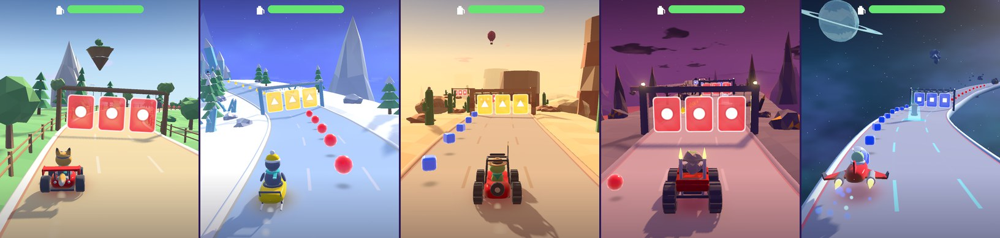
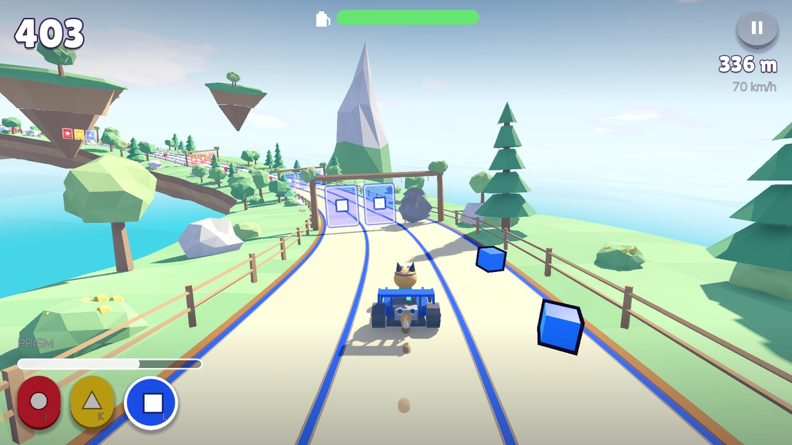
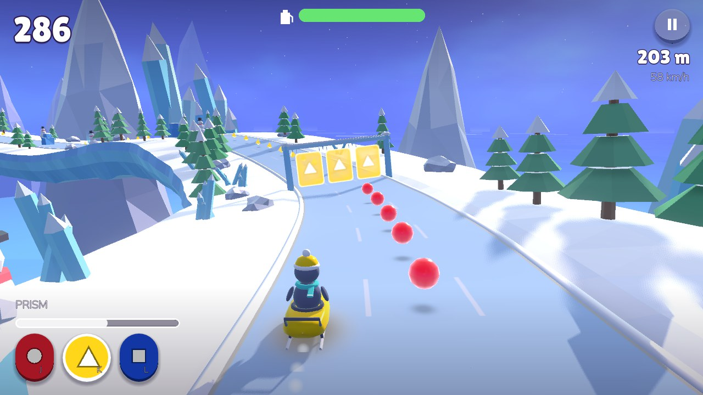
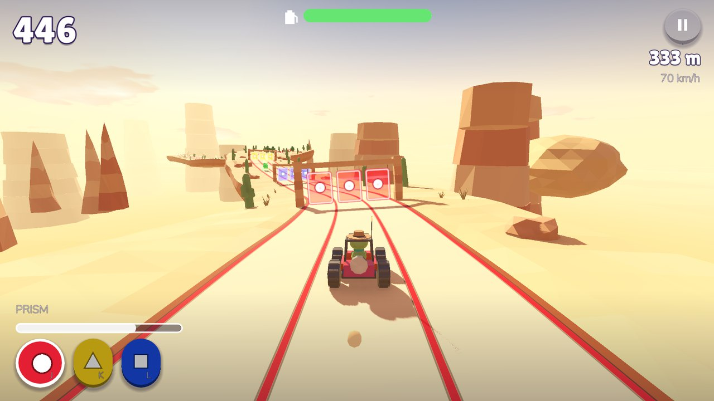
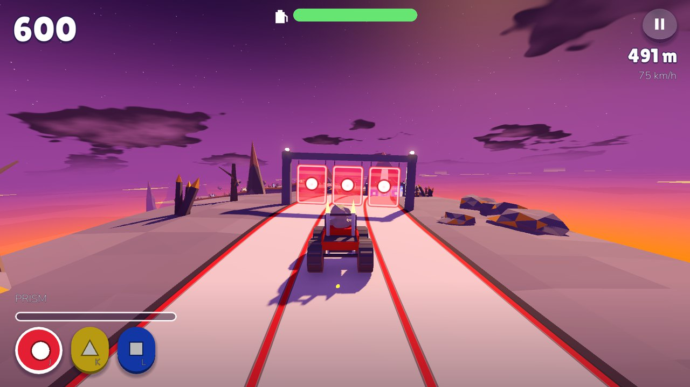
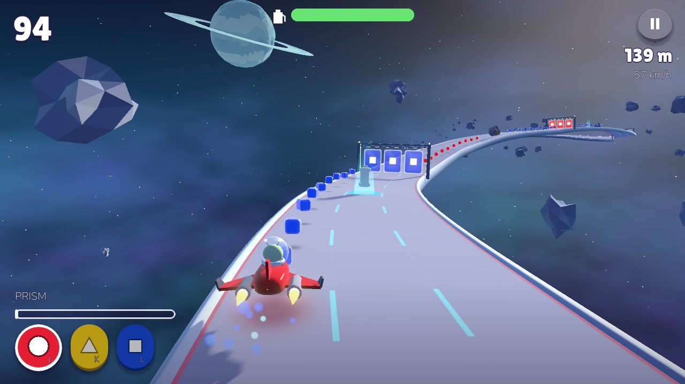
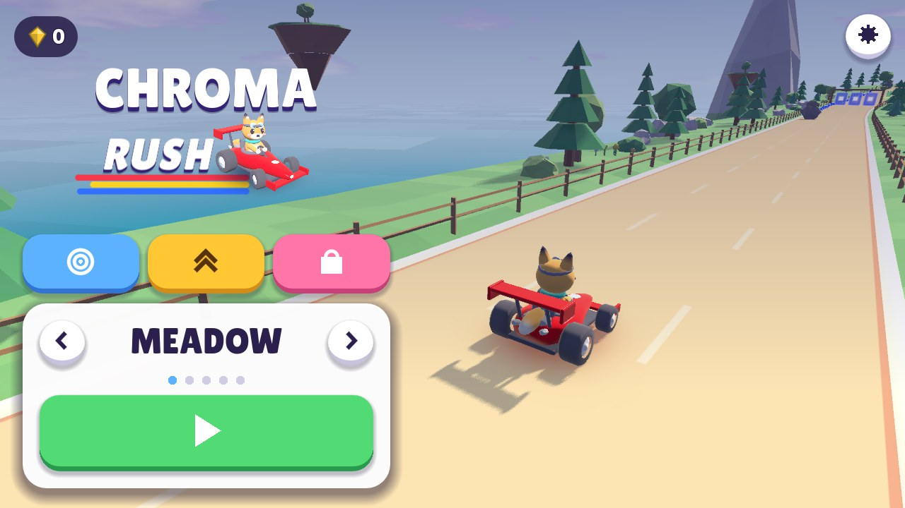
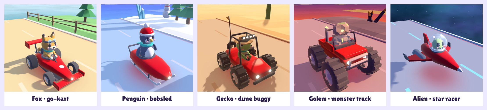
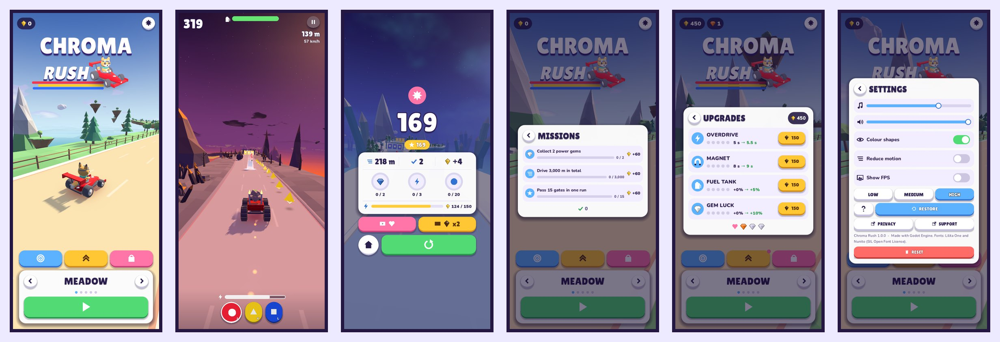

# Chroma Rush

**Match your colour, smash through the gates, race across five hand-crafted worlds.**

Chroma Rush is a colour-matching endless runner built with Godot 4. Race down a twisting road, switch your vehicle to the colour of each gate before you hit it, dodge rocks, jump hurdles and keep your fuel tank topped up. Fill the Prism meter and go into Overdrive to smash through everything in your way.



## Screenshots

| Meadow | Glacier | Canyon |
| --- | --- | --- |
|  |  |  |
| **Volcano** | **Solar System** | **Home (landscape)** |
|  |  |  |

### Drivers

Every world has its own vehicle and driver, built from smooth moulded shapes. Painted panels (and the penguin's beanie) change to the colour you have selected, and the same colour glows on the road underneath.



### On a phone

Home, in-run HUD, results, missions, upgrades and settings, in portrait:



## How to play

Each gate has a **colour and a shape**: red circle, yellow triangle or blue square. Be the same colour when you reach it, or you crash. The shapes mean the game never relies on colour alone.

| Obstacle | What to do |
| --- | --- |
| Colour gate | Switch to the gate's colour before you reach it |
| Block (rock, ice, cactus, meteor) | Change lanes to get around it |
| Hurdle (log, snowdrift, fence, lava, laser) | Jump over it |
| Fuel pickup | Drive through it; the tank drains as you go. Every pickup is in a lane you can take. If the tank is almost empty with none in reach, a fuel drop lands ahead (up to three a run) |
| Power gem | Drive through it for a power (see below) |

Passing gates and grabbing orbs fills the **Prism meter**. When it is full, trigger **Prism Overdrive**: five seconds of speed and invincibility, with orbs from every lane flying to you for double shards.

Runs start calm and build up in waves: every 500 m a short breather (wide spacing, extra orbs, a guaranteed fuel pickup) is followed by a stretch that tightens towards the next milestone. Rows are always spaced so there is time for every lane change, colour switch and jump they need.

### Power gems

Rare gems with a tall beam of light, every 700 to 1,050 m:

| Gem | Effect |
| --- | --- |
| Shield (hexagon) | Shrugs off your next crash |
| Magnet (horseshoe) | Pulls in orbs from every lane for 8 seconds |
| Full Tank (jerrycan) | Fills the fuel tank |
| Prism Charge (prism) | Fills the Prism meter |
| Phoenix Gem (cut gem, rare) | Saves a free revive for any later run (up to 3) |

### Upgrades

Shards buy five levels each of longer Overdrive, longer Magnet, a bigger fuel tank and Gem Luck (more power gems), as well as new worlds. The results screen shows how many shards the next one still needs.

### Missions

Three goals at a time, such as "pass 30 gates in one run" or "collect 140 orbs". Each pays 60 to 200 shards the moment it is completed, and a new one takes its place after the run.

### Controls

| Action | Touch | Keyboard |
| --- | --- | --- |
| Change lane | Swipe left / right | A / D or arrow keys |
| Jump / slam down | Swipe up / down | W / S or arrow keys |
| Pick a colour | Tap a colour button | J K L or 1 2 3 (Space cycles) |
| Prism Overdrive | Tap PRISM | Shift or E |
| Pause | Pause button, back button | Esc or P |

## Features

- **Five worlds**: Meadow, Glacier, Canyon, Volcano and Solar System, each with its own sky, scenery, landmarks, obstacles, gate arch, vehicle and driver.
- **Readable for everyone**: one colour set in every world, chosen to stay distinct under protanopia, deuteranopia and tritanopia, plus a shape per colour.
- **Endless and stable**: the track is generated as you drive, with bounded memory and a floating origin, so a 60 km run uses the same memory as a 1 km run.
- **Full navigation, in symbols**: home screen with a dock (missions, upgrades, shop) and world picker, how to play, pause, a scoreboard-style results screen, settings, and the Android back button. Buttons and call-outs are icons wherever an icon can say it. Lists scroll from anywhere a finger lands, and overlays close on a tap outside.
- **A soft, modern low-poly look**: no dark outlines; shapes are separated by rim light, glow and soft shadows. Glass gates, glossy gems, a calm road with light lane dashes and low kerbs, linear colour with soft bloom.
- **Smooth motion**: the vehicle glides between lanes, leans, squashes and pops on springs, with its wheels on the road; pickups and gates throw sparkles.
- **Progression**: shards from orbs, distance and missions buy upgrades and unlock new worlds; Phoenix gems bank free revives; best score per world; lifetime stats.
- **Balanced by measurement**: a human-like bot plays hundreds of game-minutes to check that runs start calm, deaths are fair, every fuel pickup can be collected and upgrades are worth having (see [docs/game-design.md](docs/game-design.md)).
- **Accessibility and comfort**: colour shapes, reduced motion, separate music and sound volume, vibration toggle, three graphics levels.
- **Built to be tiny**: every model, texture, sound and the music are generated in code. The whole game pack is about 700 KB.

## Worlds

| World | Driver and vehicle | Hurdle | Unlock |
| --- | --- | --- | --- |
| Meadow | Fox in a go-kart | Mossy log | Free |
| Glacier | Penguin on a bobsled | Snowdrift with ice spikes | 500 shards |
| Canyon | Gecko in a dune buggy | Ranch fence | 1,500 shards |
| Volcano | Rock golem in a monster truck | Lava fissure | 3,500 shards |
| Solar System | Alien astronaut in a star racer | Laser fence | 6,000 shards |

## Business model

Free to play with opt-in rewarded ads (second chance, double shards), rare interstitials that can be removed, and one-time purchases: **Supporter Pack** ($5.99), **World Pass** ($3.99) and **No Ads** ($2.99). Nothing for sale changes difficulty or score.

Product IDs, ad rules and prices live in `scripts/services/store.gd`, `scripts/services/ads.gd` and `scripts/services/economy.gd`.

## Project layout

```
main.tscn                 Game scene: world, sun, track, player, camera, UI, audio
scripts/
  game.gd                 Game flow, scoring, collisions, input, rewards, power gems
  pacing.gd               Speed, difficulty, waves, row spacing and fuel tuning
  powers.gd               Power gem kinds, looks and frequency
  track.gd                Endless path, road chunks and kerbs, rows, orbs, fuel, gems, floating origin
  player.gd               Vehicle motion on springs, ground glow, trail and sparkles
  vehicles.gd             The five vehicles and drivers, built from code
  mesh_kit.gd             Mesh builder: faceted shapes for scenery, smooth ones for vehicles and pickups
  look.gd                 Shared materials: the soft surface, glass, glow, beams, road patches
  obstacles.gd            Blocks, hurdles, gate arches and gems
  scenery.gd, props.gd    Roadside ground, props and distant landmarks
  themes.gd, defs.gd      World definitions, colours and tuning
  audio.gd                Synthesised sound effects and music
  services/               Settings, Profile (save), Missions, Store (IAP), Ads, Economy
  ui/                     UI toolkit, icons, the logo, screens and navigation
  dev/                    Developer harness, flow test, path check, icon renderer (not shipped)
shaders/                  Soft surface, glass, road, gate panel, gem, road patch, shield bubble, hazard, sky
fonts/                    Lilita One and Nunito, with their licences
icons/                    App icon source and rendered store / launcher icons
docs/game-design.md       Design goals, tuning numbers, balance measurements, look and performance
docs/screenshots/         Images used in this README
images/                   Style reference images (not shipped)
```

## Running

1. Install [Godot 4.7](https://godotengine.org/download).
2. Open `project.godot` in the editor and press Play, or run `godot --path .` from the project folder.

On desktop, debug builds use a test store and test ads, so the shop, second chance and double shards can be tried without a phone.

## Testing

A developer harness plays the real game with an autopilot. It saves to `user://dev`, never to your real progress.

```sh
# End-to-end flow checks: tutorial, pause, crash, revive, rewards, missions, unlocks, purchases, settings
godot --headless --path . res://scripts/dev/dev.tscn -- --flow-test

# Memory soak and frame times: 60 km without crashing, then memory growth and frame-time percentiles
godot --headless --fixed-fps 60 --path . res://scripts/dev/dev.tscn -- --world=meadow --autoplay --god --soak=60000 --perf

# Track shape: the path must never come close to itself (40 seeds x 15 km)
godot --headless --path . -s res://scripts/dev/path_check.gd

# Balance check: a bot with a person's reaction time and fuel habits, 20 runs, summary at the end
godot --headless --fixed-fps 60 --path . res://scripts/dev/dev.tscn -- --autoplay --tutorial-done --bot=human --runs=20 --react=0.7 --action=0.25 --fuel-skill=0.8
# ...and the same with an upgrade bought, to see what it is worth
godot --headless --fixed-fps 60 --path . res://scripts/dev/dev.tscn -- --autoplay --tutorial-done --bot=human --runs=20 --upgrades=tank:5

# Screenshots of a world or a screen
godot --path . --resolution 720x1560 res://scripts/dev/dev.tscn -- --world=canyon --autoplay --god --tutorial-done --shots=10
godot --path . --resolution 720x1560 res://scripts/dev/dev.tscn -- --world=glacier --tutorial-done --screen=shop --shots=2
```

Screenshots need a window, so they briefly open the game on screen. See the top of `scripts/dev/dev_harness.gd` for every option.

## Building for release

Export presets for macOS, Android (AAB) and iOS are in `export_presets.cfg`; the harness, tests and reference images are excluded from every build. Before a store release:

- Install the Android export template (Editor > Manage Export Templates).
- Add the [Google Play Billing](https://github.com/godot-sdk-integrations/godot-google-play-billing), [StoreKit 2](https://github.com/godot-sdk-integrations/godot-storekit2) and [AdMob](https://github.com/godot-sdk-integrations/godot-admob) plugins and enable them in the presets.
- Create the products in Play Console and App Store Connect with the IDs in `scripts/services/store.gd`.
- Put the AdMob ad unit IDs in `scripts/services/ads_admob.gd` and the privacy / support links in `scripts/ui/screens/settings_screen.gd`.
- Set up the Android keystore, and replace the free personal Apple team in the iOS preset with the paid team.

The logo's kart, the app icon and the splash are rendered from the game's own model. To regenerate them (after changing the kart or the logo), run this with a window, then re-import:

```sh
godot --path . -s res://scripts/dev/render_icons.gd
godot --headless --path . --import
```

## Credits

- Made with [Godot Engine](https://godotengine.org) (MIT licence).
- Fonts: [Lilita One](https://fonts.google.com/specimen/Lilita+One) and [Nunito](https://fonts.google.com/specimen/Nunito), under the SIL Open Font License (see `fonts/`).
- The files in `images/` are third-party style references used during development; they are not part of the game and are not included in any build.
